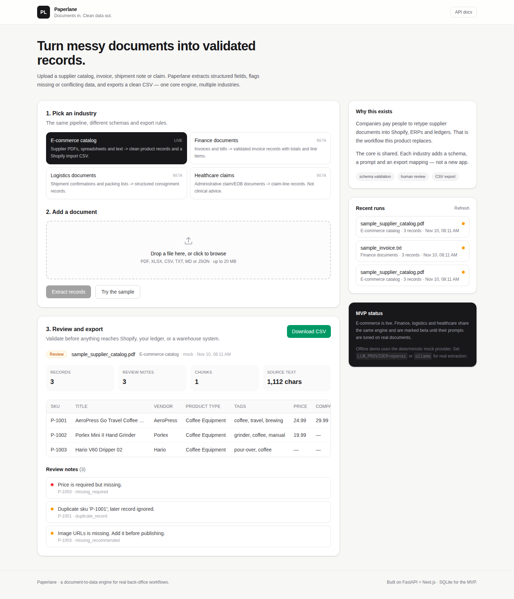

# Doc2Data

**Documents in. Clean data out.**

Doc2Data turns supplier catalogs, invoices, shipment notes and claims into validated,
structured records and an import-ready CSV. One extraction engine, four industry schemas.

Operations teams still retype these documents by hand. The hard part is not reading them;
it is getting a clean, validated record into the system of record.



## Quick start (Docker)

Requires Docker.

```bash
cp .env.example .env
docker compose up --build
```

Open <http://localhost:3000> for the app and <http://localhost:8000/docs> for the API.
Click **Try the sample**, review the extracted records, correct a value, download the CSV.

```bash
docker compose logs -f   # follow both services
docker compose down      # stop

docker compose -f docker-compose.prod.yml up -d --build   # production build
docker compose -f docker-compose.prod.yml down
```

The backend reads `.env` directly. The frontend receives only `NEXT_PUBLIC_API_URL`, so
provider keys never enter that container. The default provider is `mock`: deterministic,
offline, no API key. The bundled public samples run the same way.

### Native

```bash
cp .env.example .env

# Terminal 1 - backend
cd backend
uv sync
uv run uvicorn app.main:app --reload --port 8000

# Terminal 2 - frontend
cd frontend
pnpm install
pnpm dev -p 3000
```

## Configuration

`.env` is the single source for both compose files and native runs.

| Key | Default | Purpose |
|---|---|---|
| `LLM_PROVIDER` | `mock` | `mock`, `openrouter` or `ollama` |
| `OPENROUTER_API_KEY` | empty | required when the provider is `openrouter` |
| `OPENROUTER_MODEL` | `openrouter/auto` | any model slug from openrouter.ai/models |
| `OLLAMA_MODEL` | `gemma3:1b` | local model; `OLLAMA_BASE_URL` is detected |
| `MAX_UPLOAD_MB` | `20` | upload cap |
| `MAX_CHARS_PER_CHUNK` | `12000` | split size for long documents |
| `MAX_CHUNK_WORKERS` | `4` | chunks extracted in parallel |
| `NEXT_PUBLIC_API_URL` | `http://localhost:8000` | browser to API; baked at build in prod |
| `CORS_ORIGINS` | `http://localhost:3000` | backend allow-list |

Leave `DATABASE_PATH` unset: Docker writes `/app/data/doc2data.db` and native runs write
`backend/data/doc2data.db`. `OLLAMA_BASE_URL` follows the same rule, localhost natively
and `host.docker.internal` inside Docker. If `LLM_PROVIDER` is unset, the app uses
OpenRouter when a key is present, otherwise `mock`.

## Providers

**OpenRouter**

```env
LLM_PROVIDER=openrouter
OPENROUTER_API_KEY=sk-or-...
OPENROUTER_MODEL=openrouter/auto
```

Any model slug from <https://openrouter.ai/models> works. Name a specific model for
reproducible demos; `openrouter/auto` routes by prompt and may pick a slower model.

**Ollama (local)**

```bash
ollama pull gemma3:1b
```

```env
LLM_PROVIDER=ollama
OLLAMA_MODEL=gemma3:1b
```

On Linux, if Ollama binds to `127.0.0.1` only, expose it with
`OLLAMA_HOST=0.0.0.0:11434` in the Ollama service.

## How it works

```
upload -> read -> chunk -> LLM -> normalize -> validate -> dedupe
                                                    |
                                            review and edit
                                                    |
                                              CSV export
```

A vertical is a config: field specs, a prompt, a dedupe key and an export mapping. The
pipeline, API, review screen and export pick it up automatically. Long documents are
split at 12,000 characters and their chunks extract in parallel.

| Industry | Output |
|---|---|
| E-commerce catalog | Shopify product import CSV |
| Finance documents | Generic invoice CSV |
| Logistics documents | Generic shipment CSV |
| Healthcare claims | Generic claim-line CSV (administrative only) |

Design notes:

- **One pipeline, one config per industry.** Adding a vertical does not fork the app.
- **The model proposes, the code disposes.** Normalization, required fields, duplicates,
  totals and cross-field rules run in Python, before and after an inline edit.
- **A provider interface with a deterministic fallback.** OpenRouter, Ollama and `mock`
  sit behind one call, so demos and tests run offline.

## Speed

- Name a fast model. `openrouter/auto` may route to a slower frontier model; pick a fast
  slug from <https://openrouter.ai/models> for a demo.
- Long documents extract chunks in parallel (`MAX_CHUNK_WORKERS`, default 4). Lower it
  when one local Ollama model is the provider.
- The UI streams real stages over SSE (read, split, extract, validate, save), so a slow
  model call stays legible instead of showing an unlabeled spinner.
- Ollama on CPU is the slow path. OpenRouter is the faster option for recording.

## API

| Method | Route | Purpose |
|---|---|---|
| GET | `/api/doc2data/health` | Provider, model, verticals, database |
| GET | `/api/doc2data/verticals` | Available industry schemas |
| POST | `/api/doc2data/extract` | Upload a document (`file`, `vertical`) |
| POST | `/api/doc2data/extract/stream` | Upload a document, stream progress as SSE |
| POST | `/api/doc2data/extract/sample?vertical=ecommerce` | Run a bundled sample |
| POST | `/api/doc2data/extract/sample/stream` | Run a sample, stream progress as SSE |
| GET | `/api/doc2data/runs` | Recent runs |
| GET | `/api/doc2data/runs/{id}` | Full run, records and warnings |
| PATCH | `/api/doc2data/runs/{id}/records/{index}` | Edit a field, then re-normalize and re-validate |
| GET | `/api/doc2data/runs/{id}/export.csv` | Download the CSV |

The app uses the `/stream` routes. The plain routes stay for scripts and API clients.

## Adding an industry

Add a `VerticalConfig` in `backend/app/doc2data/verticals.py` (field specs, prompt, dedupe
key, export mapping) and register it in `VERTICALS`. The pipeline, API, review screen and
export use it automatically. The existing four are the examples.

## Development

```bash
cd backend && uv run pytest     # backend tests
cd frontend && pnpm build       # frontend production build
```

## Limits

- Scanned PDFs need OCR; the app reads embedded text only.
- E-commerce models one record per SKU; variant axes are not split yet.
- Shopify export creates draft products; images are referenced, not uploaded.
- Prompts are tuned on the bundled public samples; accuracy on arbitrary documents
  depends on the model.
- SQLite is single-instance. Production needs Postgres, object storage and a job queue.
- No auth, workspaces or billing. Inline edits overwrite the run in place; there is no
  correction history yet.
- LLM output is validated, not guaranteed. The review table is the control.
- On Vercel, request bodies are capped at 4.5 MB and the filesystem is ephemeral, so
  SQLite runs do not persist. A hosted demo needs Postgres, object storage and a
  separate API host; the Loom walkthrough is the intended local demo.

## Docs

- `./scripts/fetch_demo_docs.sh` downloads a public sample pack into `demo_docs/`
  (gitignored).
- Built on [fastapi-nextjs-starter](https://github.com/balewgize/fastapi-nextjs-starter).
